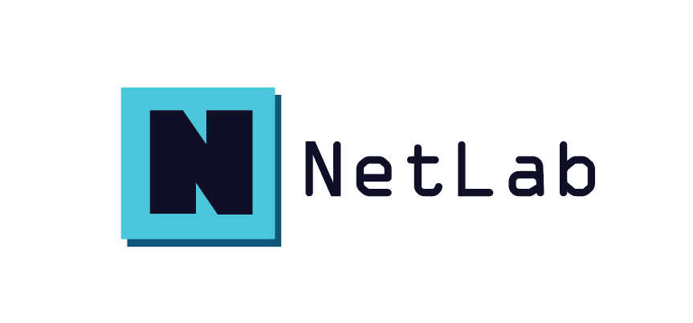

<p align="center">
    
</p>

# NetLab

### แพลตฟอร์มใช้งาน GNS3 VM บน Amazon Web Services

NetLab ช่วยให้ผู้เรียนขอสร้าง GNS3 VM บนคลาวด์ผ่านหน้าเว็บ แล้วเข้าใช้งานผ่าน EC2 บน AWS ได้ทันที โดยไม่ต้องติดตั้ง GNS3 ลงเครื่องตัวเอง ผู้สอนสามารถสร้างแบบฝึกหัดจากโปรเจกต์ GNS3 และแจกให้ผู้เรียนได้ และสามารถเพิ่ม Image อย่าง IOS หรือ QEMU เข้าไปใน GNS3 VM บนคลาวด์ได้

## ฟีเจอร์หลัก

- **Self-service** ผู้เรียนสร้าง เริ่ม หยุด ต่อเวลา และลบ GNS3 VM ของตัวเองได้
- **แบบฝึกหัดจากผู้สอน** ผู้สอนเลือกโปรเจกต์ GNS3 จาก VM ของตัวเองมาสร้างเป็นแบบฝึกหัด ผู้เรียนเริ่มทำจากโจทย์นั้นได้เลย
- **ปิดเครื่องอัตโนมัติ** VM ที่หมดเวลาจะถูกหยุดโดย Lambda เพื่อประหยัดค่าใช้จ่าย (ผู้เรียนต่อเวลาได้ก่อนหมด)
- **จัดการผู้ใช้ 3 บทบาท** Admin, Instructor และ Student
- **High availability** Frontend และ Backend กระจายหลาย AZ หลัง ALB ข้อมูลอยู่ใน DynamoDB และ S3

## สถาปัตยกรรม

```
Internet ──► ALB สาธารณะ (HTTPS :443) ──► Frontend ASG (SvelteKit + Bun, :8080)
                                                │ BACKEND_URL (เรียกจากฝั่ง server)
                                                ▼
                                       ALB ภายใน (:8000) ──► Backend ASG (FastAPI, JWT)
                                                                   │ boto3
                              ┌────────────────┬───────────────────┼───────────────┐
                              ▼                ▼                   ▼               ▼
                          DynamoDB        S3 (snapshots)     EC2 API ──► GNS3 VM นักศึกษา
                                                                              ▲
                                       EventBridge ──► Lambda auto-stop ──────┘ (หยุด VM ที่หมดเวลา)
```

รายละเอียดการ Deploy และรายการทรัพยากรทั้งหมดอยู่ใน [terraform/README.md](terraform/README.md)

## โครงสร้างโปรเจกต์

| โฟลเดอร์ | หน้าที่ |
|---|---|
| [`frontend/`](frontend/) | เว็บ SvelteKit + Tailwind CSS (JavaScript, ใช้ Bun) |
| [`backend/`](backend/) | REST API ด้วย FastAPI จัดการผู้ใช้ VM แบบฝึกหัด และสื่อสารกับ AWS ผ่าน boto3 พร้อมสคริปต์สร้าง AMI และตาราง DynamoDB |
| [`terraform/`](terraform/) | สร้างโครงสร้างบน AWS ทั้งหมด (VPC, ALB, ASG, DynamoDB, S3, Lambda) |
| `docker-compose.yml` | รัน Frontend และ Backend ด้วย Docker บนเครื่องเดียว |

## เริ่มต้นใช้งานแบบ Local

ต้องมี AWS credentials (เช่น AWS Academy Learner Lab) และ GNS3 base AMI ก่อน ดูวิธีสร้างใน [backend/README.md](backend/README.md)

**Backend** (ต้องมี Python)

```bash
cd backend
pip install -r requirements.txt
cp .env.example .env                  # แล้วกรอกค่า AWS และ AMI
python scripts/init_dynamodb.py       # สร้างตาราง (รันซ้ำได้ปลอดภัย)
python scripts/create_user.py         # สร้างบัญชีผู้ใช้คนแรก
uvicorn app.main:app --port 8000
```

**Frontend** (ต้องมี [Bun](https://bun.sh))

```bash
cd frontend
bun install
cp .env.example .env                  # ตั้ง BACKEND_URL เช่น http://localhost:8000
bun run dev                           # เปิด http://localhost:5173
```

**Docker Compose** (รันทั้งสองฝั่งพร้อมกัน)

```bash
docker compose up --build             # Frontend :8080, Backend :8000
```

ต้องมีไฟล์ `backend/.env` ก่อนรัน และตั้ง `ORIGIN` ของ Frontend ให้ตรงกับ URL ที่ใช้เปิดเว็บ ดูรายละเอียดใน [frontend/README.md](frontend/README.md)

## เอกสารคู่มือ

**สำหรับการ Develop**

- 🎨 [Frontend](frontend/README.md) การติดตั้ง ตัวแปร environment และการ build
- 🗄️ [Backend](backend/README.md) โครงสร้างฐานข้อมูล API ทุก endpoint และการทดสอบ

**สำหรับการ Deploy**

- 🏗️ [Terraform บน AWS](terraform/README.md) วิธีแนะนำ: แยก Frontend / Backend กระจายหลาย AZ หลัง ALB พร้อม GNS3 VM
- 🐳 Dockerfile: [Backend](backend/Dockerfile) · [Frontend](frontend/Dockerfile)

## ข้อควรระวัง

- **ห้าม commit** `backend/.env`, `terraform.tfvars`, `*.tfstate` หรือ GitHub token (ถูกกันไว้ใน `.gitignore` แล้ว)
- AWS credentials ของ Learner Lab หมดอายุทุก ~4 ชั่วโมง ต้องอัปเดตใน `backend/.env` ใหม่ทุกครั้งที่เปิด Lab
- เครื่อง EC2 ที่ Terraform สร้างใช้ Instance Profile แทน credentials จึงไม่ต้องคัดลอก `.env` ไปวาง
